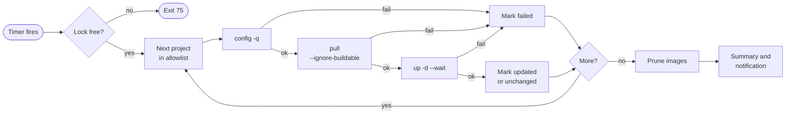

<div align="center">

# 🐳 Docker Compose Updater

**Scheduled, allowlist-based image updates for Docker Compose projects.**

A Bash script and a systemd timer. No updater container, no daemon, no agent.


[Quick start](#-quick-start) •
[Projects](#-projects) •
[Settings](#%EF%B8%8F-settings) •
[Schedule](#-schedule) •
[Usage](#-command-line-usage) •
[Troubleshooting](#-troubleshooting)

</div>

---

> [!WARNING]
> This performs **deployments**, not just image downloads. New images can introduce breaking changes, migrations, or downtime. Test first, pin versions for critical services, and keep tested backups and a rollback plan. The script does **not** roll back failed deployments.

## ✨ Features

| | |
| --- | --- |
| 📋 **Allowlist only** | Updates only the directories listed in `/etc/docker-compose-updater/projects`. |
| 🕓 **Configurable schedule** | Weekly by default (Sunday 04:00 local time, up to 15 minutes of random delay). |
| ✅ **Validates first** | Checks each Compose configuration before pulling anything. |
| 🧩 **Native file discovery** | `compose.override.yaml` and `COMPOSE_FILE` from `.env` apply exactly as with a manual `docker compose up`. |
| ⏱️ **Time limits** | Kills any docker command that runs too long, so one stuck pull cannot block the run. |
| 🧹 **Image cleanup** | Removes dangling images afterwards so old layers do not fill the disk. |
| 🔔 **Notifications** | Prints a summary of updated, unchanged, and failed projects and can pipe it to any command. |
| 🔒 **Safe to schedule** | Uses a lock against overlapping runs, logs to the systemd journal, and exits non-zero on failure. |

### 🔄 How a run works



A project that fails validation or its image pull is skipped, and the run continues with the next one.

> [!NOTE]
> Images built locally from a `build:` section are not updated; they are skipped during `pull`. Application-level health is only verified where services define Compose health checks.

## 🚀 Quick start

```bash
# 1. Install the script, units, and config files, and enable the timer
sudo ./install.sh

# 2. List the projects you want updated
sudo nano /etc/docker-compose-updater/projects

# 3. Preview, then run once by hand
sudo docker-compose-weekly-update --dry-run
sudo docker-compose-weekly-update
```

That is all that is required. Everything below is optional tuning.

## 📦 Requirements

- Linux with systemd (an Ubuntu or Debian VPS is the typical target).
- Docker Engine and the Docker Compose **v2** plugin (`docker compose`, not the legacy `docker-compose`), recent enough to support `up --wait`.
- Root or sudo access for installation, and access to each project's Compose files, `.env` files, and secrets.
- Network access to the relevant image registries.

```bash
docker --version
docker compose version
systemctl --version
```

## 🔧 Install

Clone this repository on the server (or copy it there), then run:

```bash
sudo ./install.sh
```

The installer:

- copies the script to `/usr/local/sbin/docker-compose-weekly-update` and the units to `/etc/systemd/system/`;
- creates `/etc/docker-compose-updater/projects` and `/etc/docker-compose-updater/updater.conf` with commented examples, if they do not exist;
- applies the configured schedule and enables the timer.

It never overwrites an existing allowlist or settings file, so it is safe to re-run after pulling a newer version of this repository. The initial allowlist contains no active paths; add your real project paths before the first scheduled run.

<details>
<summary><b>Repository layout</b></summary>

```text
.
├── README.md
├── LICENSE
├── install.sh
├── config/
│   ├── projects.example
│   └── updater.conf.example
├── scripts/
│   └── docker-compose-weekly-update
└── systemd/
    ├── docker-compose-weekly-update.service
    └── docker-compose-weekly-update.timer
```

</details>

## 📋 Projects

Edit the allowlist:

```bash
sudo nano /etc/docker-compose-updater/projects
```

Add one **absolute directory path** per line. Each directory must contain `compose.yaml`, `compose.yml`, `docker-compose.yaml`, or `docker-compose.yml`.

```text
# One Compose project directory per line
/opt/stacks/traefik
/opt/stacks/vaultwarden
/opt/stacks/monitoring
```

- Blank lines and lines beginning with `#` are ignored.
- A directory listed twice is updated once.
- Compose runs from each project directory, so its `.env` file, override files, and relative paths resolve from there.

> [!TIP]
> Only list projects you intentionally want deployed automatically. Keep secrets out of this repository and restrict access to production environment files.

### 🎛️ Per-project options

Options follow the path on the same line as `key=value`:

| Option | Meaning |
| --- | --- |
| `files=a.yml,b.yml` | Use exactly these Compose files (comma-separated, relative to the directory) instead of automatic discovery. Needed for non-standard filenames. |
| `wait_timeout=300` | Seconds to wait for this project's services to become running/healthy. |
| `remove_orphans=yes` | Pass `--remove-orphans` to `up` for this project. |

```text
/opt/stacks/vaultwarden wait_timeout=300
/opt/stacks/monitoring files=compose.yaml,compose.prod.yaml remove_orphans=yes
```

## ⚙️ Settings

Global settings live in `/etc/docker-compose-updater/updater.conf`. Every setting is optional.

**Precedence:** command-line flags → environment variables of the same name → settings file → defaults.

> [!IMPORTANT]
> The file is sourced by Bash, so it must be owned by root and not writable by group or others. Quote values that contain spaces.

#### 📅 Scheduling

| Setting | Default | Meaning |
| --- | --- | --- |
| `SCHEDULE` | `Sun *-*-* 04:00:00` | When the update runs. See [Schedule](#-schedule). |
| `SCHEDULE_RANDOM_DELAY` | `15m` | Random delay added to each run; `0` for the exact time. |

#### 🚢 Deployment

| Setting | Default | Meaning |
| --- | --- | --- |
| `PROJECTS_FILE` | `/etc/docker-compose-updater/projects` | Allowlist location. |
| `WAIT_TIMEOUT` | `120` | Seconds `up --wait` waits for running/healthy services. |
| `COMMAND_TIMEOUT` | `1800` | Hard limit in seconds for each docker command; `0` disables it. For `up` it is raised to at least the wait timeout plus 60 seconds. |
| `REMOVE_ORPHANS` | `no` | Pass `--remove-orphans` to `up`. |
| `DRY_RUN` | `no` | Validate and print commands without pulling or deploying. |

#### 🧹 Image cleanup

| Setting | Default | Meaning |
| --- | --- | --- |
| `PRUNE_IMAGES` | `dangling` | `dangling`, `all`, or `none`. |
| `PRUNE_UNTIL` | `168h` | Minimum image age for `PRUNE_IMAGES=all`. |

- `dangling` removes only untagged images, which is what a replaced `latest` tag leaves behind.
- `all` runs `docker image prune -a` with an age filter.
- `none` never prunes.

> [!CAUTION]
> `PRUNE_IMAGES=all` also deletes images belonging to stacks that are currently stopped. They are pulled again the next time those stacks start.

#### 🔔 Notifications

| Setting | Default | Meaning |
| --- | --- | --- |
| `NOTIFY_COMMAND` | empty | Shell command that receives the run summary on stdin. |
| `NOTIFY_ON` | `failure` | `never`, `failure`, `change` (a failure, or at least one project updated), or `always`. |

The command has 60 seconds to finish and runs with these variables in its environment:

| Variable | Value |
| --- | --- |
| `UPDATER_STATUS` | `success` or `failure` |
| `UPDATER_UPDATED` | Number of projects whose images changed |
| `UPDATER_UNCHANGED` | Number of projects already up to date |
| `UPDATER_FAILED` | Number of failed projects |

```bash
# ntfy
NOTIFY_COMMAND='curl -fsS -H "Title: Compose update $UPDATER_STATUS" --data-binary @- https://ntfy.sh/your-topic'
NOTIFY_ON=change

# mail
NOTIFY_COMMAND='mail -s "Compose update $UPDATER_STATUS" admin@example.com'
```

> [!NOTE]
> The notification runs inside the script, so it does not fire if systemd kills the whole run. Add an `OnFailure=` unit with `sudo systemctl edit docker-compose-weekly-update.service` if you need that case covered too.

#### 🔒 Locking

| Setting | Default | Meaning |
| --- | --- | --- |
| `LOCK_WAIT` | `0` | Seconds to wait for another run to finish before giving up. |
| `LOCK_FILE` | `/run/lock/docker-compose-weekly-update.lock` | Lock file location. |

## 🕓 Schedule

The default is Sunday at 04:00 in the server's local timezone, with up to 15 minutes of random delay. To change it, set `SCHEDULE` and `SCHEDULE_RANDOM_DELAY` in `/etc/docker-compose-updater/updater.conf`:

```bash
SCHEDULE="Wed *-*-* 03:30:00"
SCHEDULE_RANDOM_DELAY=0
```

then apply:

```bash
sudo docker-compose-weekly-update --apply-schedule
```

> [!IMPORTANT]
> Editing `updater.conf` alone does not change the timer. The new schedule takes effect only once applied.

`SCHEDULE` is a [systemd calendar expression](https://www.freedesktop.org/software/systemd/man/latest/systemd.time.html#Calendar%20Events). Preview one with `systemd-analyze calendar "Wed *-*-* 03:30:00"`.

| When | `SCHEDULE` |
| --- | --- |
| Weekly, Sunday 04:00 (default) | `Sun *-*-* 04:00:00` |
| Daily at 03:30 | `*-*-* 03:30:00` |
| Monday and Thursday at 02:00 | `Mon,Thu *-*-* 02:00:00` |
| First day of each month at 05:00 | `*-*-01 05:00:00` |

<details>
<summary><b>What <code>--apply-schedule</code> does</b></summary>

<br>

It validates both values, writes them to the drop-in `/etc/systemd/system/docker-compose-weekly-update.timer.d/schedule.conf`, restarts the timer, and prints the next run. It updates no projects, and the installer runs it for you.

- The service stops the whole run after 6 hours (`TimeoutStartSec`). Raise that with a drop-in for the service (`sudo systemctl edit docker-compose-weekly-update.service`) if you have many large stacks.
- `Persistent=true` lets a missed run be triggered once the timer is active again. It does not replay every missed occurrence.

</details>

## 💻 Command-line usage

```text
docker-compose-weekly-update [options] [PROJECT_DIR...]

  -c, --config FILE     Settings file
  -p, --projects FILE   Project allowlist
  -n, --dry-run         Validate projects and print what would run, change nothing
      --apply-schedule  Write SCHEDULE to the systemd timer and exit
  -h, --help            Show help
```

Naming one or more project directories updates only those. Each must already be in the allowlist.

```bash
sudo docker-compose-weekly-update --dry-run
sudo docker-compose-weekly-update /opt/stacks/traefik
```

| Exit status | Meaning |
| :---: | --- |
| `0` | Success |
| `1` | One or more projects failed |
| `2` | Usage or configuration error |
| `75` | Another run holds the lock |

## 🧪 Test before the first scheduled run

Preview what would run, then run it by hand and inspect the output:

```bash
sudo docker-compose-weekly-update --dry-run
sudo docker-compose-weekly-update
```

Then test through systemd:

```bash
sudo systemctl start docker-compose-weekly-update.service
sudo systemctl status docker-compose-weekly-update.service
sudo journalctl -u docker-compose-weekly-update.service -n 200 --no-pager
```

## 🛠️ Common operations

| Task | Command |
| --- | --- |
| Run now | `sudo systemctl start docker-compose-weekly-update.service` |
| See the next scheduled run | `systemctl list-timers --all docker-compose-weekly-update.timer` |
| Check the last result | `sudo systemctl status docker-compose-weekly-update.service` |
| Follow logs live | `sudo journalctl -fu docker-compose-weekly-update.service` |
| View this boot's logs | `sudo journalctl -u docker-compose-weekly-update.service -b --no-pager` |
| Disable the schedule | `sudo systemctl disable --now docker-compose-weekly-update.timer` |
| Re-enable the schedule | `sudo systemctl enable --now docker-compose-weekly-update.timer` |

## 🔐 Security notes

- Docker daemon access is effectively root-level access. Keep the script, systemd units, settings file, and allowlist owned by root and not writable by untrusted users.
- Do not expose the Docker API over unauthenticated TCP.
- Use least-privilege registry credentials and rotate them as needed.
- Pin versions or image digests for databases and other critical services; avoid blindly tracking `latest` in production.
- Back up persistent data and test restore procedures. A container update can succeed while an application or data migration does not.
- `up --wait` waits for services to be running/healthy where supported. Add meaningful `healthcheck` definitions to important services.
- There is no rollback after a failed health check. Use maintenance windows and a documented rollback procedure for critical services.

## 🩺 Troubleshooting

| Symptom | What to do |
| --- | --- |
| **No timer listed** | Run `sudo systemctl daemon-reload`, then `sudo systemctl enable --now docker-compose-weekly-update.timer`. |
| **Compose configuration fails** | Run `docker compose config` from the affected project directory and check `.env` files, variable interpolation, and file permissions. |
| **Image pull fails** | Check registry credentials, network/DNS, rate limits, and image names/tags. |
| **Image pull is killed** | A pull longer than `COMMAND_TIMEOUT` (30 minutes by default) is stopped and the project is marked failed. Raise the setting for very large images or slow links. |
| **Service times out** | Check the service logs and health checks, and raise `WAIT_TIMEOUT` or the project's `wait_timeout=` for slow starters. A service without a health check may count as ready once started, which is not application-level validation. |
| **Exit status 75** | Another run held the lock. Set `LOCK_WAIT` to wait for it instead of giving up. |
| **Settings file rejected** | `updater.conf` must be owned by root and not writable by group or others: `sudo chown root:root` and `sudo chmod 640`. |
| **Schedule did not change** | Run `sudo docker-compose-weekly-update --apply-schedule` after editing `updater.conf`. |

## 📚 References

- [Docker Compose `pull`](https://docs.docker.com/reference/cli/docker/compose/pull/)
- [Docker Compose `up`](https://docs.docker.com/reference/cli/docker/compose/up/)
- [systemd.timer](https://www.freedesktop.org/software/systemd/man/latest/systemd.timer.html)
- [systemd.time calendar events](https://www.freedesktop.org/software/systemd/man/latest/systemd.time.html#Calendar%20Events)

## 📄 License

Released under the [MIT License](LICENSE).
